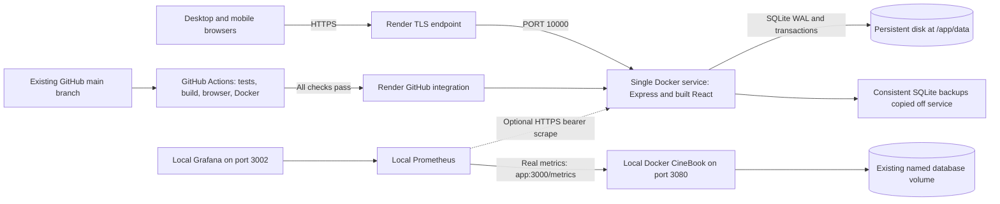

# CineBook college DevOps deployment report

Prepared 28 October 2026. **Public HTTPS service: pending owner cloud connection and paid-service approval. Public URL: not issued or verified.** This document records completed preparation separately from live deployment evidence. Update the live section after successful deployment.

## Architecture



## Inspection findings and changes

The existing repository is `C:\Users\Paras Kadam\Desktop\cinebook-devops`, backed by GitHub `Paras-kadam/cinebook-devops.`. It already contained the complete React/Express booking application, ten local poster illustrations, Vite production build, a multi-stage Debian/Node 24 Dockerfile, healthcheck, named SQLite volume, and a GitHub Actions workflow. Existing uncommitted monitoring/application changes were retained. A new website was not created.

The monitoring Compose configuration referenced missing Grafana dashboard/provider files; these are now supplied with twelve panels using real Prometheus series. Local port collisions belong to other projects and are handled by configurable CineBook host ports. The Docker healthcheck uses Node's built-in HTTP fetch, avoiding a dependency on missing curl/wget inside the slim app image. Prometheus waits for app health, and Grafana waits for Prometheus readiness.

Production preparation explicitly binds `0.0.0.0`, honors `PORT`, serves built React through Express, keeps `/api` requests same-origin, supports page refresh, and handles termination. Cloud startup refuses SQLite outside the actual mounted persistent disk and refuses absent/short metrics secrets. Helmet adds security/privacy headers; API and booking request limits return 429. Logs include safe route templates, status, and duration without booking references, emails, request bodies, or tokens. Booking validation, server pricing, atomic rollback, unique-seat constraints, existing styling, and all posters are preserved.

One baseline metrics test failed because its parser rejected a legal blank line. Its sample parser now ignores blank/comment lines while retaining numeric format assertions. Browser tests now select a fresh ignored database each run, retaining prior test and application records.

## CI/CD and Docker

CI runs for main/supported feature and fix pushes, PRs, and manual dispatch. It performs `npm ci`, `npm test`, `npm run build`, Chromium browser tests, a Docker build, and isolated container/booking persistence verification. Failure stops later steps and prevents automatic Render deployment. Reports are uploaded as GitHub artifacts, not database or secret files.

Render's GitHub connection is the deployment identity. `autoDeployTrigger: checksPass` links main's successful CI to CD without embedding deploy credentials. CI alone does not publish a website. The first service creation and manually forced deployments must be explicitly tied to an already verified main commit. Branch protection/required checks are a repository policy to review with the owner; this task does not silently change repository administration settings.

The Docker build compiles the existing Vite frontend and native SQLite dependencies on Debian/Node 24. The slim runtime receives production dependencies and built assets only, runs as `node`, and includes a database-aware healthcheck. Local Compose keeps the root filesystem read-only, drops capabilities, and mounts only its database volume writable. No monitoring admin ports are opened in the Render deployment.

## Database and monitoring

No database migration is needed. Startup creates missing tables/indexes and inserts missing seed rows without deleting existing records. The booking transaction uses an immediate write lock plus `UNIQUE(showtime_id, seat)`; conflicts return 409 and roll back the whole reservation. WAL and `synchronous=FULL` support committed data durability. Restart/replacement tests verify the same saved reference and unavailable seats. Local and cloud databases are separate unless an explicit backup/import is performed.

The local stack demonstrates both Prometheus and Grafana. Metrics cover HTTP counts/latency, committed bookings, durable database booking totals, process CPU/memory, Node heap, event loop, and uptime. Process counters reset on restart; the SQLite-backed booking gauge persists. HTTP totals include operational probes. Grafana's data source/dashboard are provisioned. Production metrics use a private bearer token; optional HTTPS scraping from local Prometheus is documented. Continuous hosted monitoring would require a separate budget.

## Commands and evidence

Run commands from the existing repository with Node 24. Use the environment/credential steps in [README](../README.md) and [deployment guide](DEPLOYMENT.md).

```text
npm ci
npm test
npm run build
npm run test:e2e
docker build --tag cinebook:local .
npm run test:docker
docker compose config --quiet
docker compose up --detach --wait --wait-timeout 180
npm run test:monitoring
npm run test:smoke
node server/backup.js
node scripts/verify-live.mjs
```

Current local verification and remote CI results are recorded in [VERIFICATION.md](VERIFICATION.md). Do not cite old ignored artifacts as a current successful run. Source backups of touched files are under ignored `.artifacts/deployment-before-*`; actual application databases and original Docker volumes were not reset or deleted.

## Live verification record to complete

| Check | Current evidence |
| --- | --- |
| Public HTTPS URL, valid certificate, homepage and ten posters | Pending real deployment |
| Movie API, details, showtimes, search/filter, phone layout | Local tests recorded; public checks pending |
| Select seats, confirm ticket, private reference retrieval | Local tests recorded; public checks pending |
| Duplicate reservation returns 409 | Local tests recorded; public checks pending |
| Same ticket survives a real Render restart/redeploy | Pending cloud disk and two-stage live test |
| Public health returns OK, anonymous metrics returns 401 | Local safeguards tested; live checks pending |
| Exact deployed main commit passes GitHub Actions | See current verification record; production commit pending |
| Local Prometheus target UP and Grafana real data | See current verification record |

## Screenshots and live demonstration

Capture actual evidence with passwords, tokens, private references, and customer information hidden:

1. Render service Live, assigned HTTPS address, verified commit, healthcheck, and 1 GB disk/mount path.
2. Browser desktop and phone homepage with ten loaded posters; search/filter results.
3. Movie details/showtimes, selected seats, booking confirmation, and successful reference lookup after refresh.
4. Before/after Render restart events plus successful persistence verification and duplicate-seat rejection.
5. A green GitHub Actions run for the exact deployed commit, with tests, browser, Docker and persistence steps visible.
6. Local `docker compose ps` with healthy services and actual host ports.
7. Prometheus target `app:3000/metrics` UP; real booking/request values before and after a demo reservation.
8. Grafana CineBook Overview with twelve populated panels and matching metric values.

Before class, open the actual verified HTTPS URL in an incognito window and on a phone, check health and recent deployment status, and avoid redeploying during the demo. Keep a private demo booking reference ready. Open local Prometheus/Grafana in separate tabs and explain that their local application metrics are distinct from the public database unless optional production scraping is enabled. Create one demo reservation, show its confirmation/lookup, then show duplicate-seat prevention. Explain GitHub → CI → Render CD, Docker's multi-stage build, and the persistent disk. A local-only demonstration must not be presented as completed public deployment.
